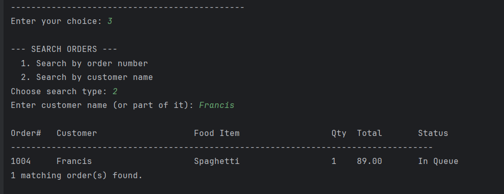
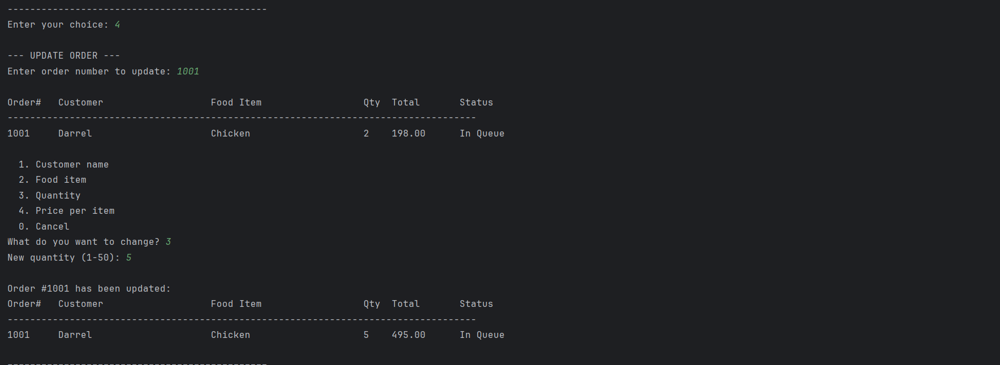
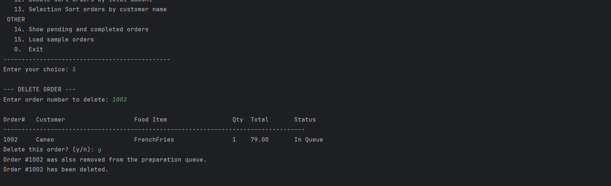
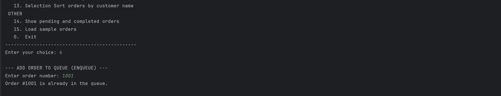
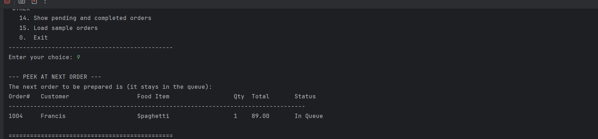

# Food Ordering and Preparation Queue System

A console-based Java application for a small restaurant or cafeteria. It records customer orders, places them in a preparation line, and lets staff prepare them in the order they arrived. Sorting algorithms written from scratch help staff review the order records.

**Name:** Francis Silva  
**Course / Section:** BSIT/IT2A  
**Instructor:** Miguel Edward Rosal

---

## Project Description

In a busy cafeteria, orders pile up quickly. If staff prepare orders in a random sequence, customers who came first end up waiting longest, which is unfair and causes complaints. Staff also need a quick way to look through the day's orders, for example to find the biggest orders or to look up a customer alphabetically.

This system handles both problems:

1. **Queue (FIFO):** Orders placed in the preparation queue are prepared strictly in the order they were added. The first order in is the first order out.
2. **Sorting:** The recorded orders can be sorted by total amount (Bubble Sort) or by customer name (Selection Sort) so staff can review them easily.

The program uses procedural programming only. There are no custom classes or objects. All logic lives in `static` methods and all data is kept in `ArrayList`s.

## Objectives

- Store and manage food order records using several synchronized `ArrayList`s.
- Implement Bubble Sort and Selection Sort manually, without any built-in sorting method.
- Manage the preparation line with a `Queue` (`LinkedList`) that follows FIFO.
- Make sure sorting the records never changes the order in which orders are prepared.
- Provide a menu-driven console interface that validates input and never crashes on bad data.
- Support adding, displaying, searching, updating, and deleting orders.

## Use Cases and Features

| Menu | Feature | What it does |
|------|---------|--------------|
| 1 | Add new order | Records customer name, food item, quantity, and price. Total is computed automatically. Offers to queue the order right away. |
| 2 | Display all orders | Shows every record in a table. |
| 3 | Search | Find an order by order number or by customer name (partial, not case-sensitive). |
| 4 | Update | Change the customer name, food item, quantity, or price of an order that is not yet completed. |
| 5 | Delete | Removes an order from every list. If the order was in the queue, it is removed from the queue too. |
| 6 | Enqueue | Adds one waiting order to the back of the preparation queue. |
| 7 | Enqueue all waiting | Adds every waiting order to the queue, lowest order number first. |
| 8 | Dequeue | Prepares the order at the front of the queue and marks it Completed. |
| 9 | Peek | Shows the next order without removing it. |
| 10 | Display queue | Shows the queue from front to back with positions. |
| 11 | Check if empty | Reports whether the queue is empty. |
| 12 | Bubble Sort | Sorts records by total amount (ascending or descending). |
| 13 | Selection Sort | Sorts records by customer name (A to Z or Z to A). |
| 14 | Pending / Completed | Lists pending orders and completed orders separately. |
| 15 | Load sample orders | Adds five sample orders, useful for testing and screenshots. |
| 0 | Exit | Closes the program. |

Order status moves through three stages: `Waiting` (recorded), `In Queue` (waiting to be prepared), and `Completed` (prepared).

## Data Structure Explanation

### ArrayLists (records)

Each order is spread across six parallel `ArrayList`s. The value at index `i` in every list belongs to the same order.

| ArrayList | Type | Holds |
|-----------|------|-------|
| `orderIds` | `Integer` | Order number (starts at 1001) |
| `customerNames` | `String` | Customer name |
| `itemNames` | `String` | Food item ordered |
| `quantities` | `Integer` | Number of items |
| `totalAmounts` | `Double` | Quantity multiplied by price |
| `statuses` | `String` | Waiting, In Queue, or Completed |

Whenever a record is added, deleted, or swapped during sorting, all six lists are changed together so the indexes stay aligned. The method `swapRecords(a, b)` swaps all six lists at once, and `deleteOrder()` removes the same index from all six.

### Queue (preparation line)

```java
static Queue<Integer> prepQueue = new LinkedList<>();
```

The queue stores **order numbers only**, not full records. This is the key design decision:

- The record lists can be sorted freely, and the queue is not affected because it only holds order numbers.
- When an order is dequeued, the program looks up its record with `findIndexById(id)`.

| Queue operation | Method used |
|-----------------|-------------|
| Enqueue | `prepQueue.add(id)` |
| Dequeue | `prepQueue.poll()` |
| Peek | `prepQueue.peek()` |
| Display | iterate with a for-each loop (front to back) |
| Empty check | `prepQueue.isEmpty()` |

## Sorting Algorithm Explanation

Both algorithms are written by hand. No `Arrays.sort()`, `Collections.sort()`, or other built-in sorting is used. Both use `swapRecords()` so every ArrayList stays in sync.

### 1. Bubble Sort: by total amount (`bubbleSortByTotal`)

**How it works:** The algorithm walks through the list and compares each pair of neighbors. If a pair is out of order, they are swapped. After each pass, the largest remaining value has "bubbled" to its final position at the end. If a full pass makes no swaps, the list is already sorted and the algorithm stops early.

**Why it fits this use case:** Order totals are numbers, and a restaurant's daily list is small. Bubble Sort is simple to follow and the early-exit check makes it fast when the list is already nearly sorted. Staff use it to see the biggest or smallest orders first.

### 2. Selection Sort: by customer name (`selectionSortByName`)

**How it works:** For each position from the front, the algorithm scans the unsorted part to find the smallest (or largest) name, then swaps it into place. Names are compared with `compareToIgnoreCase`, so uppercase and lowercase do not affect the result.

**Why it fits this use case:** Selection Sort makes at most one swap per position, which means fewer record swaps. Since each swap moves six lists, that is a real saving. It is a good match for alphabetical lookup of customers.

### Sorting and the queue

Sorting changes only the **record lists**. The queue holds order numbers in arrival order, so the FIFO sequence is unaffected. The program prints the queue before and after each sort to show this.

## How to Run the Program

**Requirements:** Java Development Kit (JDK) 8 or newer.

Check your installation:

```bash
java -version
javac -version
```

Compile and run from the project folder:

```bash
javac -d out src/Main.java
java -cp out Main
```

On Windows Command Prompt the same commands work. If `javac` is not recognized, install a JDK and make sure it is added to your PATH.

## Screenshots of the System

All screenshots were taken from the running application.

### 1. Main menu

*The main menu showing all available options, from order records to queue operations, sorting, and exit.*

### 2. Adding records and displaying stored records

*Orders 1001 to 1004 (Darrel, Caneo, Phoenix, Francis) shown in the stored records table, with quantity, computed total, and status.*

### 3. Searching records

*Search by customer name (option 3, then 2). Typing "Francis" returns order 1004 and reports 1 matching order.*

### 4. Updating a record

*Updating order 1001 (Darrel, Chicken). Changing the quantity from 2 to 5 recalculates the total from 198.00 to 495.00.*

### 5. Deleting a record

*Deleting order 1002 (Caneo). Because the order was still in the queue, it is removed from the preparation queue as well as from the records.*

### 6. Queue operations
Enqueue, peek, display, and the empty-queue check are shown here. Dequeue is shown in section 7.


*Enqueue (option 6) on order 1001. The order is already in the queue, so the program refuses to add it a second time.*


*Peek (option 9) shows order 1004 (Francis, Spaghetti) as the next order. It stays in the queue.*


*Display queue (option 10) lists the queue from front to back. Order 1004 (Francis) is marked as next, followed by order 1005 (Hale), with 2 orders in the queue.*


*Display queue (option 10) when nothing is queued. The program shows "The queue is empty." instead of failing.*

### 7. FIFO behavior

*First in: option 7 adds the waiting orders to the queue in order-number sequence: #1001 (Darrel), #1002 (Caneo), #1003 (Phoenix).*


*First out: option 8 (dequeue) prepares order #1001 (Darrel) first, the order that was added first. The next in line is #1002 (Caneo).*

### 8. Bubble Sort (before and after)

*Bubble Sort by total amount, ascending. The records go from 79.00 up to 177.00 in 3 swaps. The queue order #1013 -> #1014 -> #1015 -> #1016 is the same before and after.*


*Bubble Sort by total amount, descending. The records go from 177.00 down to 79.00 in 6 swaps. The queue order stays #1013 -> #1014 -> #1015 -> #1016.*

### 9. Selection Sort (before and after)

*Selection Sort by customer name, A to Z, in 1 swap. Order #1013 (Darrel) is already Completed and the queue stays #1014 -> #1015 -> #1016.*


*Selection Sort by customer name, Z to A, in 2 swaps. The queue order is unchanged by the sort.*

### 10. Input validation and error messages

*Invalid menu entries: the words "francis" and "silva" are rejected as not whole numbers, and 23 and 16 are rejected as outside the 0 to 15 range. The menu keeps asking until a valid choice is entered.*

## Test Cases

**Test data.** Most cases use these four orders, entered through option 1 and queued in this sequence:

| Order# | Customer | Food Item | Qty | Price | Total |
|--------|----------|-----------|-----|-------|-------|
| 1001 | Darrel | Chicken | 2 | 99.00 | 198.00 |
| 1002 | Caneo | FrenchFries | 1 | 79.00 | 79.00 |
| 1003 | Phoenix | Burger | 3 | 59.00 | 177.00 |
| 1004 | Francis | Spaghetti | 1 | 89.00 | 89.00 |

**Sorting data set.** The sorting screenshots were taken with these four orders (Darrel's quantity is 1 here). Order numbers depend on how many orders were added earlier in the same run.

| Order# | Customer | Food Item | Qty | Price | Total |
|--------|----------|-----------|-----|-------|-------|
| 1013 | Darrel | Chicken | 1 | 99.00 | 99.00 |
| 1014 | Caneo | FrenchFries | 1 | 79.00 | 79.00 |
| 1015 | Phoenix | Burger | 3 | 59.00 | 177.00 |
| 1016 | Francis | Spaghetti | 1 | 89.00 | 89.00 |

Test cases 15 to 20 use the sorting data set. The other cases use the first table.

| # | Scenario | Steps | Expected result |
|---|----------|-------|-----------------|
| 1 | Add valid order | Option 1: name `Darrel`, item `Chicken`, qty `2`, price `99`, answer `n` to queueing | Order #1001 saved, total 198.00, status Waiting |
| 2 | Invalid name | Option 1, enter `Darr3l` as the name | Error message, name prompt repeats |
| 3 | Invalid quantity | Enter `0`, `51`, `abc` as quantity | Error each time, prompt repeats |
| 4 | Invalid price | Enter `-5`, `0`, `abc` as price | Error each time, prompt repeats |
| 5 | Invalid menu choice | Enter `francis`, `silva`, `23`, `16`, or a blank line at the menu | Error message each time, menu prompt repeats |
| 6 | Empty list | Choose 2, 3, 4, 5, 12, 13 before adding any order | "No orders" style message, no crash |
| 7 | Empty queue | Choose 8, 9, 10 with nothing queued | "The queue is empty" message |
| 8 | Check empty | Option 11 on an empty queue, then after queuing | "EMPTY", then "NOT empty" with the order count |
| 9 | Enqueue one by one | Add Darrel and Caneo, option 6 with `1001`, then `1002` | Queue shows #1001 -> #1002 |
| 10 | Duplicate enqueue | Option 6 with `1001` twice | Second attempt says it is already in the queue |
| 11 | Missing order | Option 3, 4, 5 or 6 with order `9999` | "No order found" message |
| 12 | Enqueue all waiting | Add Darrel, Caneo and Phoenix, then option 7 | Queue shows #1001 -> #1002 -> #1003 |
| 13 | FIFO | After test 12, option 8 | Order 1001 (Darrel) is prepared first and marked Completed; next in line is 1002 (Caneo). Repeating option 8 completes Caneo, then Phoenix |
| 14 | Peek | Option 9 after test 12 | Shows order 1001 (Darrel); it stays in the queue |
| 15 | Bubble Sort ascending | Option 12, choose ascending | Totals 79.00 (Caneo), 89.00 (Francis), 99.00 (Darrel), 177.00 (Phoenix), 3 swaps |
| 16 | Bubble Sort descending | Option 12, choose descending | Totals 177.00, 99.00, 89.00, 79.00, 6 swaps |
| 17 | Selection Sort A to Z | Option 13, choose ascending | Caneo, Darrel, Francis, Phoenix (screenshot run: 1 swap) |
| 18 | Selection Sort Z to A | Option 13, choose descending | Phoenix, Francis, Darrel, Caneo (screenshot run: 2 swaps) |
| 19 | Sort keeps queue intact | Queue all four orders, run either sort | The "Queue order" line reads #1013 -> #1014 -> #1015 -> #1016 before and after |
| 20 | Records stay synchronized | Sort, then search order `1015` | Phoenix, Burger, 3, 177.00 still match |
| 21 | Search by name | Option 3, choose name search (2), enter `Francis` | Lists order 1004 (Francis, Spaghetti) and reports 1 matching order |
| 22 | Update quantity | Option 4, order `1001`, choose Quantity (3), enter `5` | Quantity becomes 5 and total recalculates to 495.00 |
| 23 | Update price | Option 4, order `1001`, choose Price per item (4), enter `120` | Total recalculates to 600.00 (5 x 120) |
| 24 | Update completed order | Complete order 1001, then try option 4 on it | Refused with a message |
| 25 | Delete queued order | Option 5, order `1002` (Caneo, In Queue), answer `y` | Message that order 1002 was also removed from the queue, then deleted from the records |
| 26 | Pending / Completed | Complete two orders, then option 14 | Pending and completed orders listed separately with counts |

## Project Structure

```
DSA-Java-Sorting-Queue-Capstone/
├── src/
│   └── Main.java
├── screenshots/
│   ├── Main_Menu.png
│   ├── Adding_and_Displaying_Orders.png
│   ├── Search.png
│   ├── Update.png
│   ├── Delete.png
│   ├── Enqueue.png
│   ├── Peek.png
│   ├── Display_queue.png
│   ├── Empty_queue.png
│   ├── FIFO_first_in.png
│   ├── FIFO_first_out.png
│   ├── Bubble_sort_Ascending.png
│   ├── Bubble_Sort_Descending.png
│   ├── Selection_Sort_Ascending.png
│   ├── Selection_Sort_Descending.png
│   └── Input_Validation.png
├── .gitignore
└── README.md
```

## Notes on Procedural Design

- The only class is `Main`, which Java requires as the program entry point. No other classes, objects, inheritance, or interfaces are used.
- Data is stored in static `ArrayList`s and one static `Queue`.
- Every feature has its own `static` method.
